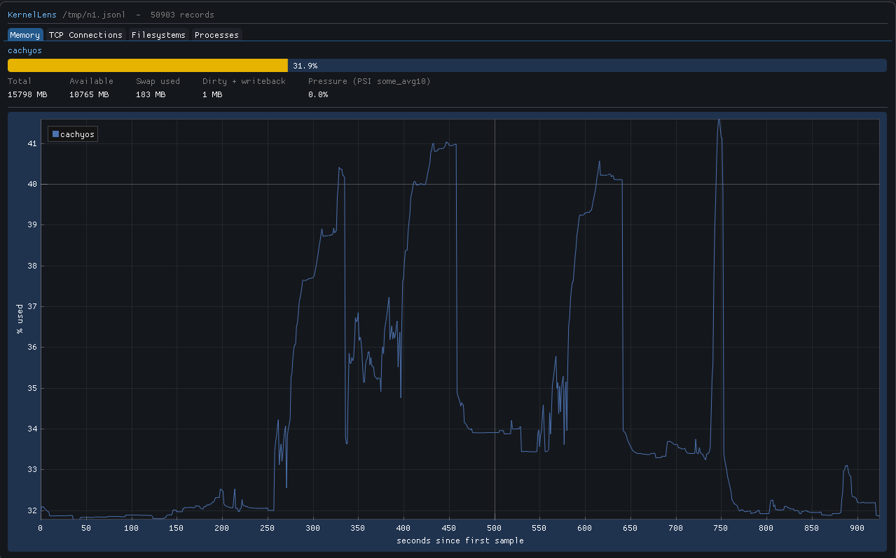

# KernelLens

Requirements: C++20 compiler and make.



Installation

```
make
sudo make install
```

GUI (requires glfw3):

```
make gui
./kernellens-gui /tmp/n1.jsonl
```

Run fault on one node:

```
sudo ./kernellens-agent --out /tmp/n1.jsonl &
sudo ./experiments/inject.sh --fault cpu --run-dir /tmp/run
kill %1; cp /tmp/n1.jsonl /tmp/run/
./kernellens-report /tmp/run
```

Faults: `cpu`, `mem`, `disk`, `fs`, `net`, `none`. Multi-node: `./experiments/run.sh --nodes web1,web2,db1 --target db1 --fault disk`.
